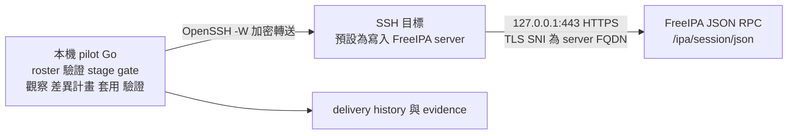

# 本機 Go 經 SSH tunnel 執行 FreeIPA reconcile 改善計畫

日期：2026-10-15。狀態：設計提案，尚未實作或完成效能驗證。2026-10-15 修訂：架構由「遠端 Go helper」改為「本機 Go 經 SSH tunnel 連 JSON-RPC」。同日再修訂：新增 Phase −1、Phase 2 混合執行模型、test driver 與 spec row 對應檢查、Phase 3 規模與 go/no-go。

目標是將日常 identity reconcile 改為本機 pilot 內的 Go engine：pilot 用系統 OpenSSH 建立到 FreeIPA 寫入 server 的 TCP 轉送，經轉送以 HTTPS 呼叫 FreeIPA JSON-RPC API，用密碼登入取得 session，共用連線、批次讀取現況，只套用實際差異。遠端不安裝或發布任何程式。FreeIPA 安裝與主機設定繼續由現有部署流程負責。

本計畫提供架構、交付順序及驗收條件。新套件與介面名稱均為擬議名稱；既有 roster schema 不因這次實作自行升版。文件不提供尚未實跑的操作 SOP。

## 1 已知瓶頸與基準限制

2026-10-15 經 pilot MCP 查詢 FreeIPA 主機紀錄，得到下列歷史 API 活動區間。時間已由主機 UTC 轉為台灣時間。

| 活動區間 | 首末 API 紀錄跨度 | API 呼叫數 |
|---|---:|---:|
| 2026-10-12 11:37–12:04 | 27.26 分鐘 | 1,372 |
| 2026-10-14 16:12–16:39 | 27.19 分鐘 | 1,378 |
| 2026-10-14 16:54–17:20 | 25.91 分鐘 | 1,381 |

活動區間依連續 server log 推算，沒有 delivery run ID 對應，不能當成精確的 CLI 起訖或完整成功驗收。這些數字用來定位瓶頸，正式比較必須在相同測試環境重新建立基準。

最後一段有 118 次 user-add、118 次使用者屬性 user-mod、118 次密碼狀態 user-show、84 次 passwd、32 次 SSH key user-mod、130 次 group-add-member，以及 117 次 user-enable。至少 568 次回覆 DuplicateEntry、EmptyModlist、AlreadyActive 或 AlreadyInactive，約占 41%。SUCCESS 不代表一定有資料變更，membership 結果還需檢查逐成員結果。

目前 [identity apply](../../../playbooks/apply/freeipa-identity-apply.yml) 對使用者、群組、host、HBAC、sudo 等進行多輪逐筆 CLI 呼叫；移除 Ansible 但保留相同 CLI 迴圈，仍會保留主要的無效工作。密碼重設條件另有既有回歸，先在 Phase −1 修正（見 §5），不能將反覆重設視為必要的 reconcile 成本。

## 2 架構選擇

| 方案 | 優點 | 代價與判斷 |
|---|---|---|
| 本機 Go 直接連 FreeIPA HTTPS | 最少執行層 | 本機需能直連 443 並解析 FQDN；多數環境只開 SSH。保留為同一 dialer 的替代設定，不作預設 |
| **本機 Go 經 SSH tunnel 連 JSON-RPC** | 沿用 SSH 入口；diff、plan、journal 都在本機 Go，可單元測試；遠端不需安裝程式、版本協商或多平台建置；密碼登入由 server 端處理 Kerberos，本機不需連 KDC | SSH 目標必須允許 TCP forwarding；每次 RPC 多一段 SSH 往返，需靠 batch 與 session 重用。**本計畫採用** |
| 本機 Go 經 SSH 啟動遠端 Go helper | 使用遠端環境的 CA、DNS、Kerberos | 需 helper bootstrap、發布、版本協商與 amd64/arm64 測試，換不到額外正確性。不採用；只在 tunnel 被證明不可行時重新評估 |
| Go 經 SSH 逐筆呼叫 ipa CLI | 遷移幅度小 | 保留每筆 CLI 啟動和認證成本，不採用 |

SSH 只負責轉送；管理 FreeIPA 的介面是 JSON-RPC。正常 reconcile 不在本機或遠端執行 ipa CLI 或 ansible-playbook；遠端只執行固定的唯讀或鎖指令（見 §3）。初期可保留一次性的 inventory 解析及 vault 解密相容工具，需列入計時；「核心 reconcile 不依賴 Ansible」與「整個 pilot 不依賴 Ansible」是不同交付範圍。

認證流程依 FreeIPA 官方 JSON-RPC 說明：以 `POST /ipa/session/login_password`（form 欄位 `user`、`password`，帶指向 `https://<fqdn>/ipa` 的 Referer）取得 session cookie，之後以 `Content-Type: application/json` 與相同 Referer 呼叫 `/ipa/session/json`。[FreeIPA JSON-RPC 文件](https://freeipa.readthedocs.io/en/latest/api/jsonrpc_usage.html)

FreeIPA 官方描述了 batch 呼叫；batch 可合併 RPC 往返，本計畫不將它視為交易或平行執行保證。[FreeIPA API 文件](https://freeipa.readthedocs.io/en/latest/api/basic_usage.html#batch-operations)

## 3 模組與傳輸契約

| 項目 | 責任與預計位置 |
|---|---|
| roster adapter | 重用 `internal/inventory` 的載入、驗證、grants 編譯與語意規則，轉為型別明確的 desired state |
| reconcile engine | 新增 `internal/identityreconcile`：observer、planner、executor、verifier、operation journal；在本機 pilot process 執行，可獨立測試 |
| FreeIPA writer | 新增 `internal/freeiparpc`：password login session、cookie、Referer、CA pin、typed API、完整讀取、batch、錯誤分類；以 method allowlist 限制可用寫入與物件範圍 |
| SSH dialer | 新增 `internal/sshdial`：由 effective inventory 解析 SSH 目標，以 OpenSSH `-W` 提供 `net.Conn`；讀取 CA、遠端鎖、取消與逾時 |
| CLI 與 delivery | 接入 `cmd/pilot/cmd/reconcile.go`、catalog dispatch、既有 stage/availability gate、history 與 webhook |

既有 [freeipaaccess](../../../internal/freeipaaccess/kerberos.go) 已使用 Go Kerberos/SPNEGO 與 JSON-RPC，但 [method allowlist](../../../internal/freeipaaccess/jsonrpc.go) 刻意唯讀。新 writer 不得擴大 gateway reader 的能力；如抽取共用的 JSON-RPC envelope 或 transport，reader 保留自己的型別介面、keytab 認證與 allowlist，並有拒絕寫入的 regression test。既有 [SSHEnvironment](../../../internal/sandbox/ssh.go) 依賴 Ansible，不能直接當作新核心傳輸。

### SSH tunnel

- Go 呼叫系統 OpenSSH，保留已驗證的 known_hosts、ssh-agent 與 ProxyJump 行為，不自行重做 SSH 設定語意。ssh 參數以 argv 傳遞，不經 shell。
- 目標必須由本次 effective inventory 解析成唯一 host、address、port、user、環境及寫入 FreeIPA server。列出支援的 SSH 選項；不支援的設定在 mutation 前明確拒絕，不默默忽略。SSH 目標預設為寫入 server 本身。
- `http.Transport` 的 DialContext 不使用本機 DNS 或本機 port：每條連線啟動 `ssh -W <目的地>`，把子程序 stdin/stdout 包成 `net.Conn`。不用 `-L` 開本機 listening port，避免同機其他使用者共用轉送。Transport 不讀 `HTTP(S)_PROXY` 環境變數。
- request URL、TLS ServerName、Host 與 Referer 一律使用寫入 server 的 FQDN；轉送目的地預設為 `127.0.0.1:443`，可設定為 `<fqdn>:443` 由 SSH 端解析。Phase 0 實測確認 FreeIPA httpd 在 loopback 接受此組合。
- 保持單一 keep-alive 連線並重用 session；連線斷開時重新 dial，已送出寫入的處理見 §4。若使用 ControlMaster，ControlPath 為本次 run 專用（注意 AGENTS.md §5.11 的 108 bytes 限制），run 結束即關閉，不重用 Ansible 或其他 run 的 socket。
- SSH 上只有固定用途：`-W` 轉送、讀取 CA、持有遠端鎖。roster、使用者名稱、密碼與 API 參數只出現在 TLS 內的 HTTP body，不進 ssh argv 或 remote command。
- sshd 若設 `AllowTcpForwarding no`、`DisableForwarding yes`，或 `PermitOpen` 不含目的地，`ssh -W` 會被 server 拒絕。repo 內 `pilot-access-target-policy` 的 strict profile 會關閉 forwarding，remote-dev profile 只開 `PermitOpen localhost:*`（只套用於符合其 Match 條件的來源），這是預設目的地選 loopback 的原因之一。preflight 在任何 mutation 前實際建立 tunnel、登入並呼叫 `ping`；失敗即停止並說明原因，不自動修改 sshd 政策。
- 登入後記錄 FreeIPA server 與 API version，核對支援清單；每次 run 綁定同一寫入 server，不在中途切到 replica。
- SSH 連線、TLS handshake、登入、每個 RPC 與整輪都有 deadline。取消或 tunnel 斷開時停止排程新操作；已送出的 RPC 在 server 端可能仍會完成，結果標為未知，保留 journal 並查證。

### 認證與權限

- SSH 身分只用來建立 tunnel，不代表任何 FreeIPA 權限；不能假定 root、host keytab 或已有 kinit ticket 有權管理 roster。
- 第一階段使用既有 vault 的 `ipa_admin_password`（與舊 playbook 同一來源），以 login_password 取得 session。密碼只存在 pilot process 記憶體與 TLS 內的 POST body；不進 argv、環境、plan、事件、journal 或暫存檔。本機與遠端都不 kinit，不使用、覆寫或清除任何 credential cache。session cookie 同樣視為 secret，不寫入 log 或 journal。
- 後續評估專用 service account 與最小 FreeIPA RBAC，仍以密碼登入，因此不需要 KDC。需處理該帳號的密碼到期與輪替（登入回報密碼過期時明確失敗），且不得啟用 OTP 等需要互動的 auth type。實測每種操作需要的權限，包含密碼重設；不假定 gateway reader keytab 可用。若日後要改用 keytab/SPNEGO，需另外證明本機能經 tunnel 連 KDC，未證明前不採用。
- session 有時效。讀取遇 401 可重新登入一次後重送；寫入遇 401 只有在 Phase 0 實測證明 401 發生於指令執行前時才可重送，否則視為 unknown。
- CA 取自操作者提供的檔案，或每輪經已驗證 host key 的 SSH 讀取寫入 server 的 `/etc/ipa/ca.crt`。CA 只存在記憶體、只信任這一張，不寫入持久 trust store。驗證 server FQDN 與 TLS hostname；禁止用略過 TLS 驗證處理名稱不一致。
- 認證方式、委派權限與支援 API 版本先由 Phase 0 證明；未通過則停在該里程碑，不能用逐筆 CLI 偷換成完成版。

## 4 差異更新與失敗語意

### 執行流程

1. 載入本次 inventory 與 roster，重用 completeness、stage、staging/prod confirm、attestation 及 grants lifecycle 規則。記錄 desired revision、target identity、FreeIPA server/API version。
2. 在寫入 server 上取得排他鎖：另開一條 SSH session 以固定指令對固定路徑執行 `flock` 並持有到整輪結束；SSH 中斷時遠端程序結束、鎖釋放。舊 engine 的 pilot 入口在呼叫 ansible-playbook 前取得同一把鎖，因此不同控制主機與 workspace 都互斥。鎖路徑與權限由 Phase 0 決定，須讓所有 pilot 入口使用的 SSH 身分都能取得。手動執行 ansible-playbook 或其他 IPA 管理工具不受鎖控制，仍需處理外部變更。
3. 建立 tunnel 與 session。批次讀取 managed users、groups 與所需參照，確認結果完整，產生穩定排序的 plan、操作依賴及去敏 diff。
4. 在實際套用前重新讀取權威狀態，核對 desired revision、目標、有效時間與 live preconditions。plan 的舊快照只能用於預覽，不可授權 mutation。若變更擴大原計畫或失效，回報 conflict 並重新規劃。
5. 每批寫入前檢查所需 live preconditions；共用 session 送出有界 batch，逐項判讀錯誤、membership failed/completed 與結果。依賴有先後的操作不能放進依賴伺服器隱含順序的 batch。
6. 重新讀取結果並驗證 effective state。記錄 observed changes、成功、失敗、未知結果與未執行項目，再釋放 session、tunnel 與鎖。

### 必須保持的行為

- 批次 find 需處理 truncation、size limit、權限造成的缺欄位及不完整結果。未證明完整時禁止 authoritative prune；按所需 managed 名稱補查或有界分割查詢，不假設 FreeIPA 提供通用 page token。以超過 server 限制的資料量測試。
- 欄位未宣告與宣告空集合分開處理；直接成員與間接成員分開比較。未知欄位不可當成空值。只修改 roster 管理的欄位與物件，保留外部管理資料。
- user-add 只針對不存在者；user-mod 僅包含不同欄位；enable/disable 只在狀態不同時執行；membership 以新增／撤銷集合合併呼叫。SSH key 比較保留既有 authoritative 語意。
- 查詢 live state 的失敗不等於物件不存在。建構 desired state 的本地快取不能取代 live drift 檢查；長時間預覽後、每次寫入前及寫入後須使用當下權威狀態。
- JSON-RPC 缺乏通用原子 compare-and-swap 的情境，明列外部 writer 競爭的剩餘風險；刪除與權限收斂前即時重讀，遇到衝突停止，寫後再次驗證，不宣稱整輪交易隔離。
- 密碼初始化僅適用於已證明尚未初始化的帳號；「使用者尚未完成首次改密碼」不能單獨觸發重設。`force_password` 的明確重設意圖與舊行為差異須在 acceptance contract 說明，不擅改既有使用者密碼政策。
- 密碼重設不能安全 read-back 比對；傳送後逾時或中斷標示 unknown，不自動重試。schema 尚無一次性 reset 識別時，先明確界定人工再次執行的語意，不能假裝已有 exactly-once 保證。
- HTTP 200、SSH 正常結束、batch 外層成功都不是完整成功。逐 operation 驗證，失敗不發送成功 webhook；無變更時 mutation API 數為 0。

### 失敗與恢復

FreeIPA 多物件更新不是交易。run journal 記錄 operation ID、前置條件、去敏差異、狀態及驗證結果；不得包含密碼、session cookie 或密碼可離線猜測的摘要。重啟後先重讀 live state，再決定哪些工作仍有必要。

讀取可有界重試；寫入逾時或 tunnel 中斷先查證，不直接重送或切 replica。刪除、密碼重設等不可逆操作不宣稱自動還原。可逆補償也須檢查當下狀態，避免覆蓋其他人的修改。engine 選擇綁定整輪，部分寫入後不自動 fallback 到舊 playbook。

## 5 分階段交付

### Phase −1 現有 playbook 的低成本修正與基準

這一階段只改現有 Ansible 路徑，不依賴 Go engine，先消除已知的無效工作並取得可比較的基準。

**密碼重設回歸。** 修正前「Set password for users that need one」task 的條件是 `force_password or needs_reset`，其中 `needs_reset` 為「沒有 Kerberos key，或 `krbPasswordExpiration <= krbLastPwdChange`」。這造成兩個問題：

- `force_password: true` 的使用者每輪都被重設，即使已自行改過密碼。`b425fb4`（2026-07-17）為修正「新使用者沒有密碼」，把原本的 `and` 改成 `or`；從此 [identity spec](../../verification/freeipa-identity.md) §7.4「使用者自行設定的密碼不被覆蓋」不再成立。§7.4 的實測紀錄是 2026-07-16，早於這次修改。
- `force_password: false` 但尚未完成首次改密碼的使用者，也每輪被重設。
- playbook 完全沒讀 roster schema 的 `password.preserve_existing`（`freeipa-config.md` §6.4，預設 true）。

§1 最後一段的 84 次 passwd 來自前兩類。

- [x] 密碼語意改依 roster schema（2026-10-15 決定並實作，spec v1.12）：沒有 Kerberos key 時初始化；`preserve_existing: true`（預設）不動已有的密碼；`preserve_existing: false` 要求重設，使用者還在上次重設的密碼時不重複；`force_change` 不決定要不要重設，`force_change: false` 目前沒有作用（列為已知缺口）。`user-show` 失敗時 fail closed；兩個旗標必須是 boolean。
- [x] 以真實 `ipa user-show --all --raw` 擷取確認判斷屬性：`maxlife` 為 0 時，使用者自行改密碼後 `krbPasswordExpiration` 不存在，舊條件會因此每輪重設；現在視為已自行改過。
- [x] regression test（`internal/spec/freeipa_identity_password_regression_test.go`）以真實擷取涵蓋上述狀態，並在拋棄式 vm-target 開發期實跑 R0–R4（spec §7.4）。
- [x] candidate `edc840f` 從乾淨 checkout 實跑 PASS，證據 `docs/evidence/freeipa-identity/2026-10-15-edc840f.md`；`ipa passwd` 失敗被吞掉另開 #102。

**基準。**

- [x] 基準量測（2026-10-15，見下）。

**基準量測結果（2026-10-15）**

環境：拋棄式 vm-target（2 vCPU、4 GB，AlmaLinux 9.8、FreeIPA 4.13.4），控制端在同一台主機。修正前為 `main`（`f9fb701`），修正後為 PR #109 head（`a746511`，含 #103、#106、#109），皆從乾淨 worktree 以 `ansible-playbook` 執行；每個 task 的時間取自 `ansible.posix.profile_tasks`，API 呼叫取自 server 的 `/var/log/httpd/error_log`。

資料集（比照正式環境的呼叫量）：
- 120 users：70 未登入、48 已自行改密碼、2 停用；40 人各有一把 SSH key。
- 40 groups：team／role／access／data 各 10，含 130 筆使用者成員與 20 筆巢狀成員。
- 10 hosts、5 hostgroups、10 HBAC rules、5 sudo rules。

修正前每輪 1,361 次 API 呼叫、86 次 passwd，與正式環境的 1,381、84 次相近。

| 情境 | 版本 | 整輪時間（秒） | API 呼叫 |
|---|---|---|---|
| 首次套用（全部新建） | 修正後 | 1,081 | 1,519 |
| 穩態重跑（無差異） | 修正前 | 882、848、861 | 1,361 |
| 穩態重跑（無差異） | 修正後 | 890、1,056、990、811、838 | 1,189 |
| 只改一位使用者的 email | 修正後 | 925 | 1,189 |

最後三輪以修正後、修正前、修正後交錯執行，主機負載相近（load 約 1.0–1.4）：811、861、838 秒。

穩態各 section（修正後交錯兩輪平均）：

| users | groups | passwords | HBAC | sudo | hosts | hostgroups | gates |
|---|---|---|---|---|---|---|---|
| 484 秒（58%） | 111 秒 | 92 秒 | 48 秒 | 44 秒 | 20 秒 | 19 秒 | 8 秒 |

修正前的 passwords 為 157 秒。

觀察：
- **密碼修正的效果**：API 呼叫少 172 次（86 次 passwd，加上 CLI 每次 passwd 附帶的 86 次 `command_defaults`），passwords 段少約 65 秒。在相近負載下整輪約快 4%，小於同版本重複執行的差異（811–1,056 秒）。
- **穩態重跑的呼叫都是白做的**：`changed=0`，但仍有 1,189 次呼叫。
  - 620 次回 no-op：EmptyModlist 310、DuplicateEntry 190、AlreadyActive 118、AlreadyInactive 2。
  - 230 次是讀取。
  - 其餘 SUCCESS 也沒有改變任何東西，例如 150 次已是成員的 `group_add_member`、120 次 CLI 自身的 `command_defaults`。
- **耗時與有沒有差異無關**：每次 `ipa` CLI 呼叫中位數約 0.8 秒（含 Ansible loop item），整輪約等於「呼叫次數 × 0.8 秒」，所以只改一位使用者和完全沒改一樣久。正式環境 26 分鐘、約 1,380 次呼叫，換算每次約 1.1 秒，比這台 VM 慢。
- **對照 §6 目標**：users／groups／passwords 約 690 秒，目標 ≤ 30 秒；完整 identity 約 810–1,056 秒，目標 ≤ 180 秒。
- **Phase 3 go/no-go 的推估**：users／groups／passwords 以外的 section 在這台 VM 合計約 140 秒。若 Phase 2 讓 users／groups 降到 30–40 秒，混合執行可能剛好達到 180 秒；但正式環境每次呼叫較慢，同樣的 section 約 190–200 秒，會略超過。Phase 3 是否需要，應在 Phase 2 之後以接近正式環境的延遲重新量測再決定。
- **選做項目的潛力**：本節的 Ansible 側批次讀取可省掉多數 no-op 呼叫，包括 user-add 120、user-enable 118、無差異的 user-mod、group-add／mod 80、已是成員的 group-add-member 150，量級是一半以上的呼叫。它可以作為 Go engine 之外的低成本選項，與 Phase 0 一併評估。
- **量測時發現的 bug**：roster 的 `ssh_keys.values: []` 不會撤銷使用者最後一把 key（task 回報 ok，key 仍在），已開 #113。
- [x] 選做：能以真實擷取鎖住解析格式時，對 user-add、user-enable 先用一次批次讀取排除已存在或狀態相同的使用者。完整欄位差異比較留給 Go engine，不在 Jinja 另做一套 diff。（2026-10-16 實作並延伸到 group-add 與 group-add-member，spec v1.15，PR #119，見下）

**批次讀取結果（2026-10-16）**

- 作法：在 `Ensure IPA users exist` 之前執行兩次讀取，`ipa user-find --pkey-only --sizelimit=0 --timelimit=0`，以及加上 `--disabled=True` 的同一指令。已存在的使用者跳過 `user-add`；帳號已是宣告的啟用／停用狀態時，跳過 `user-enable`／`-disable`。不在清單裡的使用者，兩個呼叫照舊執行。
  - 不用預設輸出：預設輸出含使用者可以自己改的姓名，含換行的姓名可以偽造另一位使用者的 `Account disabled:` 行。登入名不能含換行。
  - 讀取失敗、結果被截斷，或解析出的登入名數不等於 FreeIPA 印出的筆數時，run 在任何使用者變更之前失敗。例如 server 的系統語系是德文時，`ipa` 印德文，這道 gate 會擋下。
- 穩態量測：同一台 VM、同一份 120 users 資料集，與 PR #109 head（`a746511`）交錯各跑兩輪，主機 load 約 1.3–2.9。

  | 版本 | 整輪時間（秒） | API 呼叫 |
  |---|---|---|
  | 批次讀取 | 612、623 | 831 |
  | `a746511` | 795、856 | 1,189 |

  - 少掉的 358 次呼叫：`user_add` 120 次（DuplicateEntry），加上 CLI 每次 `user-add` 前附帶的 `command_defaults` 120 次；`user_enable` 118 次（AlreadyActive）、`user_disable` 2 次（AlreadyInactive）；多了 2 次 `user_find`。
  - 整輪約快 25%。users 段仍有 240 次 `user_mod` 回 EmptyModlist（姓名等屬性與 SSH key 各一次）、120 次 `user_show`（密碼狀態），另有 150 次已是成員的 `group_add_member`、各 40 次 `group_add`／`group_mod` no-op。這些需要欄位差異比較，依上面的界線留給 Go engine。
- 延伸到群組：用 `ipa group-find --pkey-only` 跳過已存在的 `group-add`。成員查詢已讀出的直接成員不再 `group-add-member`，名冊列出的間接成員仍會加成直接成員。
- candidate `01fcc5d` 實跑（`docs/evidence/freeipa-identity/2026-10-16-01fcc5d.md`）：穩態與 `a746511` 交錯量測，共三輪。

  | 版本 | 整輪時間（秒） | API 呼叫 |
  |---|---|---|
  | `01fcc5d` | 519.7、479.0 | 642 |
  | `a746511` | 845.5 | 1,189 |

  新增、停用、啟用、加成員只發出必要的呼叫。server 語系為德文時，兩道 gate 在任何變更前擋下。
- 與 §6 目標的差距：穩態整輪約 480–520 秒，目標 180 秒。剩下的呼叫：
  - 240 次 `user_mod` 與 40 次 `group_mod` 回 EmptyModlist，需要欄位比較才能跳過；
  - 120 次 `user_show` 與 80 次 `group_show` 讀取；
  - hosts／HBAC／sudo 約 160 次。

  Ansible 路徑每次 `ipa` CLI 呼叫的固定成本約 0.8 秒，再減少呼叫也難以達標。2026-10-16 使用者回報正式環境的耗時「長官嫌太久」，因此進入 Phase 0。

退出條件：§7.4 重新成立並有實跑證據；穩態重跑的 passwd 數符合 contract；基準數字已記錄。本階段依 AGENTS.md 走 candidate、vm-target test 與 evidence 流程。

### Phase 0 契約與傳輸實驗

**初步量測（2026-10-16，唯讀）**

本機 Go 程式（未提交）以 `ssh -W 127.0.0.1:443` 連到拋棄式 VM `pwfix-ipa` 的 loopback HTTPS：
- TLS 的 ServerName 是 server FQDN，CA 取自 server 的 `/etc/ipa/ca.crt`（pin）。
- 以 `login_password`（帶 Referer）取得 `ipa_session` cookie，之後全部呼叫共用這個 session。
- 只呼叫 ping、`*_find`、`user_show` 與 `batch`。資料集同上（138 users、87 groups）。

| 項目 | 結果 |
|---|---|
| 建立 tunnel、TLS 與登入 | 約 0.8 秒；含取得 FQDN、CA，整體約 3 秒 |
| ping × 50 | p50 52 ms、p95 56 ms；`ipa` CLI 每次約 800 ms |
| `user_find --all`（138 筆，197 KiB） | 469 ms |
| `group_find --all`（87 筆，含成員） | 1.85 秒 |
| hostgroup／host／hbacrule／sudorule `_find --all` | 各 290–393 ms |
| `user_show --all`，120 人逐一呼叫 | 33.7 秒（每次 281 ms，server 端成本為主） |
| 同上改成一次 `batch` | 5.7 秒 |
| 177 次 HTTP 呼叫使用的 `ssh -W` 程序 | 3 個 |

觀察：
- **整份 live state 用 6 次 `*_find --all` 讀完**，合計約 3.7 秒，不需要逐物件 `*_show`。
- **穩態**理論上只剩這些讀取加上比較，mutation 為 0，users／groups 的 30 秒目標與完整 identity 的 180 秒目標都有餘裕。有差異時，每個寫入約 50 ms 加上 server 端成本。
- **`*_show --all` 的 server 端成本**約 230 ms，遠高於傳輸。需要逐物件讀取時用 `batch`，或改用 `*_find --all`。
- **連線重建**：httpd 的 keep-alive 每條連線約 100 個請求就關閉，連線會重建（每次一個新的 `ssh -W`，約 0.8 秒）。Phase 0 要確認上限的實際值，並決定是否以 `batch` 降低請求數。
- 這段量測之後的項目已在下面完成，只剩正式環境的 SSH RTT 與 FreeIPA 版本需在接入前確認。

- [x] 先建立 verification acceptance contract 與現有功能對照矩陣，再實作 mutation；確認 user/group 範圍與密碼語意。（`docs/superpowers/specs/2026-10-16-freeipa-go-reconcile-phase0-contract.md` §3、§4；engine 專屬條件於 Phase 1 轉成可執行檢查）
- [x] 用拋棄式 FreeIPA server/client VM 驗證：`ssh -W` dialer、loopback 目的地加 FQDN SNI、login_password session（Referer、cookie、CA pin）、session 重用、session 到期與 401 語意、batch 逐項結果、遠端鎖的取得與中斷釋放。
- [x] 實測 SSH 中斷、RPC 逾時、權限不足、API 不相容、hostname/CA 不符、sshd 禁止 forwarding，證明 mutation 前失敗或結果未知能正確呈現。（API 不相容：server 不拒絕任何版本，改由 client 檢查，以擷取與單元測試證明）
- [x] 取得實際 API fixtures 與基準（含 SSH RTT），列出支援的 FreeIPA 版本，不使用自編成功字串作 fixture。（支援清單目前只有實測過的 FreeIPA 4.13.4／API 2.257；正式環境的版本與 SSH RTT 需在接入前確認）

退出條件：本機 Go 經 SSH tunnel 能在指定 VM 上直接查詢及變更單一測試帳號，共用 session，重跑不產生多餘寫入；密碼與 session cookie 不洩漏。

**結果（2026-10-16）**：candidate `ba253a6` 在拋棄式 VM 實跑 PASS，退出條件成立，見 `docs/evidence/freeipa-go-reconcile/2026-10-16-ba253a6.md`。PR #120 review 後，修正「缺欄位的成功回應被當成有效結果」與「含寫入的 batch 解析失敗沒有歸為 unknown」，candidate `33e38e4` 重跑 PASS，見 `docs/evidence/freeipa-go-reconcile/2026-10-16-33e38e4.md`。
- 單一帳號建立、改一個欄位各一次寫入；重跑零寫入，server log 核對一致。
- session 在 server 端結束後，只重登一次，寫入只套用一次。
- 中斷的寫入回報 unknown，實際未套用；逾時的寫入回報 unknown，實際已套用。所以 unknown 一定要讀回。
- 密碼與 cookie 在輸出與 server log 都是 0 次。
- Phase 1 尚未開始。

### Phase 1 唯讀 observer 與 planner

- [ ] 實作完整性判斷、正規化、差異與依賴排序，先僅提供 preview/shadow comparison。
- [ ] 測試 no-op、單人變更、外部 drift、nested membership、空集合、保留外部資料、逾期 grants 及大量資料截斷。
- [ ] plan 綁定 desired revision、target 與能力範圍；live state 變更時必須重新評估。
- [ ] 建立 Go reconcile test driver：在 vm-target 上 snapshot → preview → apply → verify → 第二輪零 mutation，失敗時 rollback，輸出可放進 evidence 的摘要（tested revision/tree、PASS/FAIL、API 計數）。driver 經 pilot 正式入口執行，不直接呼叫內部函式。本階段先完成 snapshot、preview、verify 與 rollback，apply 與第二輪檢查在 Phase 2 接上。
- [ ] 建立 spec row 對應檢查：每個 users/groups 相關 row 對應到 planner 的 operation 種類與 verifier 檢查，雙向鎖住（row 沒有對應，或程式宣告的對應不在 spec，都要 fail），比照 `TestSpecPlaybookTagAlignment`。相容期內舊 playbook 仍受 `TestSpecPlaybookTagAlignment` 約束，兩個檢查都要通過。新檢查要先把一個 regression 放回去，確認它會 fail（AGENTS.md §5.7）。

退出條件：讀取無 mutation，計畫能解釋每個操作；不支援的 roster section 明確阻擋對應範圍。

### Phase 2 使用者與群組 MVP

- [ ] 實作使用者屬性、enabled state、SSH keys、群組及直接／巢狀 membership 差異更新。
- [ ] 保留群組 durable history marker、使用者 absent/preserved lifecycle、managed ownership 與相關刪除保護；未完成的 destructive 操作先拒絕。
- [ ] 完成密碼初始化／明確重設、unknown 結果、journal 與恢復流程。
- [ ] 提供明確 opt-in 的 users/groups scope；其它 section 只作參照，不宣稱整份 identity 已 reconcile。全量入口遇到未支援功能必須在任何寫入前拒絕，不能靜默略過。
- [ ] 實作下述混合執行模型。

退出條件：新增、修改、撤銷、外部 drift 修復、第二輪零 mutation、失敗重跑均通過 live target；達成 users/groups 的效能目標；混合執行的全量 run 通過 live target，且其後以舊 engine 全量重跑時 users/groups 相關 task 為 changed=0。

#### 混合執行模型

Phase 2 之後、各 section 搬移完成之前，全量 identity reconcile 以混合方式執行。否則全量 run 仍會跑舊 playbook 的 users/groups 迴圈，實際耗時不會下降。

- 一次 pilot run 只持有一把鎖（§4 步驟 2），涵蓋兩個 engine。
- 順序：先由 Go engine 套用並驗證 users/groups，再執行舊 playbook 的其餘 section。HBAC、sudo、netgroup 等會引用使用者與群組，必須排在後面。
- 舊 playbook 以明確變數（擬議名稱 `identity_users_groups_engine=go`）跳過 users/groups 的 mutation task，不用 `--skip-tags users,groups`：帶這些 tag 的 task 也設定後續 section 讀取的 fact（例如 `ipa_active_users`），依 AGENTS.md §4.4，跳過 setter 會讓 reader 讀到未定義值。
- regression test 鎖住：設定該變數時，users/groups 沒有任何 mutation task 執行、後續需要的 fact 仍被設定、其餘 section 的 task 不變；在帶 `--tags` 的 run 下也要成立。
- Go engine 失敗或有 unknown 結果時，不執行舊 playbook。舊 playbook 失敗時，run 回報 partial：users/groups 已提交、其餘 section 失敗；兩者都是 reconciler，修正後重跑即可。
- delivery history 與 webhook 是同一筆 run，分別記錄兩個 engine 的結果；兩者都成功才算成功。
- 相容性驗證：混合 run 之後，再以舊 engine 全量執行一次，users/groups 相關 task 必須 changed=0。不為 0 代表兩個 engine 對 desired state 的解讀不同，啟用混合模式前須查明原因。

### Phase 3 完整 identity 相容性

#### 規模與 go/no-go

Phase 3 等於把現有 identity playbook 的其餘部分改寫成 Go。2026-10-15 的規模：

- playbook 3,328 行、136 個 loop、約 50 種 `ipa` 子指令；identity spec 34 列。
- 25 個非測試 Go 檔引用這支 playbook（呼叫者與 roster 編譯）。
- 帶 section tag 的 task 數：sudo 29、HBAC 23、hosts 23、groups 19、users 16、netgroups 15、hostgroups 8、nfs 5、password policy 4、auth policy 3。

現有 playbook 的許多判斷來自真機才抓到的 bug（AGENTS.md §5.6、§5.12–§5.14），搬到 Go 時每一項都要重新以真實擷取與 live target 驗證。因此 Phase 3 不在 Phase 2 完成後自動開始：

- 依 Phase −1 與 Phase 2 的量測，取得混合執行下的全量耗時與逐 section 時間。
- 全量中央流程 p95 已符合 §6 的 180 秒門檻時，不以效能為由進行 Phase 3；混合執行就是穩態，直接進入 Phase 4，只切換已搬移的範圍。
- 未符合時，依各 section 的耗時占比排序，逐 section 搬移。每個 section 是獨立子階段，有自己的 spec row 對應、退出條件與證據；完成一個再決定下一個。
- 以正確性或維護成本為由搬移某個 section 時，須寫明具體理由（例如某類 bug 在 Ansible 中反覆發生），不以「統一架構」作為唯一理由。

以下項目在各 section 的子階段中適用：

- [ ] 搬移 host/hostgroup/netgroup、HBAC、sudo 與 commands/options/run-as、automount、帳號到期、password policy、authentication types/indicators、grants 與 prune state。
- [ ] 保留 HBAC break-glass／allow_all 防護、IPA server/replica auth-indicator guard、host 刪除前 service/授權參照與 DNS ownership 驗證。
- [ ] 檢查 [accessgrants](../../../internal/accessgrants/reconcile.go)、[history probes](../../../internal/freeipa/probe.go)、gateway scope、decommission 及所有舊 identity 呼叫者；維持共用契約與跨入口鎖，避免兩套 writer 同時執行。
- [ ] client SSSD refresh 與中央 reconcile 分別計時，沿用 availability/deferred host 契約；若要求立即 client 生效，對受影響主機做有界 SSH fan-out，逐台記錄結果。中央成功但 client refresh 失敗須回報 partial，並測試真實 allow/deny，不以清快取代替正確性驗證。

退出條件：全部支援的 roster 能力、既有 lifecycle 入口及實際登入／sudo 正反案例通過，才允許完整 identity 切換。

### Phase 4 入口整合與預設切換

- [ ] 在現有 reconcile 入口增加明確 engine 選擇（舊 engine、混合、全部 section 搬移後的完整 Go engine），接回 stage gate、preview、確認、delivery history、MCP read-only drill-down 及 webhook。
- [ ] 加入真實 CLI/TUI 入口到遠端結果的整合測試，不只測底層 engine；若新增 prompt，同步 automation schema 與 scenarios。
- [ ] 完成舊 engine 的手動回退流程：先確認沒有進行中的 writer、查證 partial/unknown，重新規劃，禁止失敗後自動雙重套用。
- [ ] 已搬移範圍（混合執行或完整 Go engine）通過相容性與效能驗收後，經既有上線授權切換預設；保留一段相容期，再另行評估移除舊路徑。

## 6 效能與正確性驗收

以下為建議 acceptance target，不是已測量的效能承諾。Phase 0 若發現不合理之處，須說明原因後更新契約，不能為通過測試而靜默放寬。

| 情境 | 建議門檻 |
|---|---|
| 120 users／40 groups，無差異 | users/groups 核心流程 p95 ≤ 30 秒，mutation API = 0 |
| 同規模只修改一位使用者的非密碼屬性 | p95 ≤ 30 秒，僅該物件必要寫入，其他使用者 passwd = 0 |
| 同規模一次新增或修改 100 位使用者 | users/groups 流程 p95 ≤ 120 秒，重跑 mutation API = 0；明確重設作業另列 |
| 完整 identity，約現有規模 | 混合執行或 Phase 3 後，中央流程 p95 ≤ 180 秒，SSSD refresh／replication 分項呈現 |
| 1,000 users／200 groups | 全部結果完整，無截斷誤刪；記錄 read/write/API 次數與成長曲線 |

量測包含 SSH 連線、tunnel 建立、登入、live reads、plan、freshness check、apply 與 verify；記錄 SSH 新連線／重用、SSH RTT、FreeIPA 版本、CPU/RAM 與資料關係數。人工確認、鎖等待及 client refresh 另外呈現，也提供整輪 wall time，不能用移除驗證來美化效能。

舊／新 engine 使用相同 VM 資源、相同資料集及等價功能範圍。舊 engine 基準取自 Phase −1 修正後的版本，避免把密碼回歸的成本算成新 engine 的收益。每個正式 p95 情境至少 20 次樣本；mutation benchmark 每次從相同前置狀態恢復，初次新增與無變更重跑分開。新 user-only 路徑不可直接與舊全量 identity 的 26 分鐘比較並宣稱加速倍數。

API 指標區分 HTTP 往返、batch 子操作、read、mutation、noop、retry、unknown；禁止只把 HTTP 數降低當成 server 工作量降低。每次 RPC 都多一段 SSH 往返，先用 session 重用、batch 與差異更新取得收益，再用測量決定是否增加有界並行；同一物件及相依操作維持順序。

正確性必測：新增與撤銷、nested group、保留外部資料、明確空值、停用／到期帳號、history marker、密碼不重設、權限不足、不完整查詢、batch 部分失敗、tunnel 中斷、session 到期、取消、重啟恢復、plan 過期、grants 時間跨界、兩個 pilot writer 與外部修改競爭。HBAC／sudo 需從 enrolled client 驗證 allow 和 deny，並區分中央提交與 replica/client 傳播時間。

## 7 證據與發布條件

每個里程碑依 AGENTS.md 先確定 acceptance spec、實作與 regression tests。正式 target evidence 從不可變 candidate commit 的乾淨隔離 checkout 執行，記錄 revision/tree、FreeIPA server/API version、SSH 目標與轉送目的地、target/inventory 與 execution-affecting hashes。

保留 target provisioning 的 sanctioned pilot 流程；新的 Go reconcile test driver 必須涵蓋 preview → apply → verify → 第二輪零 mutation，不能把既有 vm-target test 的 Ansible-only 結果當成新 engine 證據。本方案不需在遠端安裝程式；若某環境需要調整 sshd forwarding 政策才能使用 tunnel，那是另一個 playbook 變更，須依 repo 規則有 spec、stage gate 與實跑證據，不由 reconcile 自行修改。

完整診斷與失敗輸出放在 `.verification/` 或 evidence store，提交 sanitized evidence 摘要；成功後的文件更新採 evidence-only commit。runbook 的可執行步驟僅在對應環境實跑後加入。變更共用 JSON-RPC 程式碼時須回歸 gateway 唯讀權限邊界；涉及併行程式碼執行 race 檢查。

本計畫完成的標準是可評估的遷移與驗收設計；功能交付的標準是所有適用階段通過上述實測。writer 帳號權限、API 相容性、SSH forwarding 可用性及 destructive 語意是 Phase 0／acceptance contract 必須釐清的項目，不能假定已由本次計畫請求授權正式環境變更。
